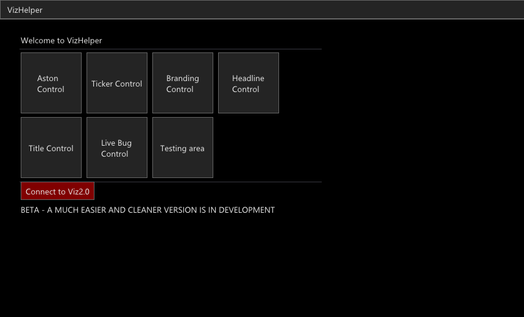
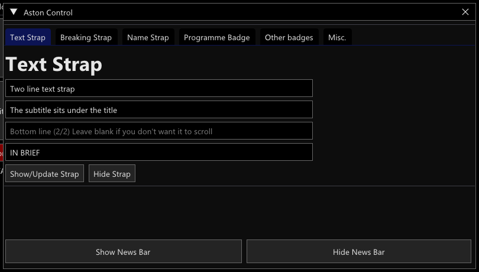
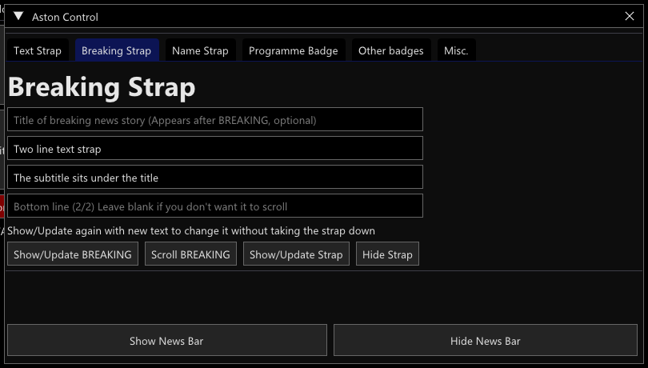
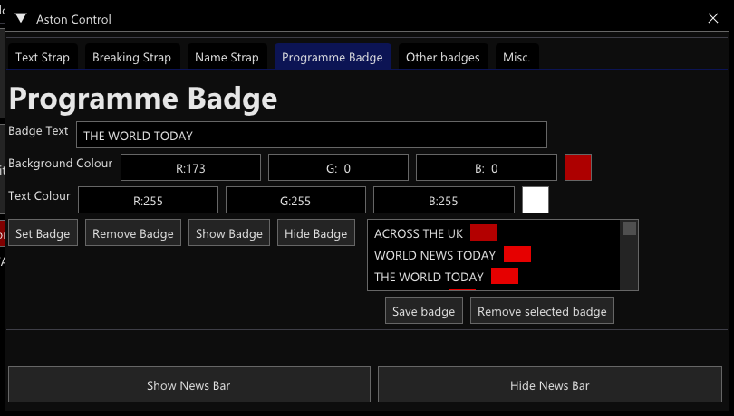
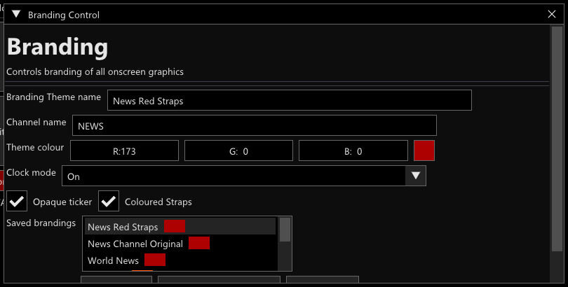
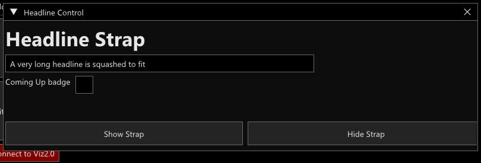
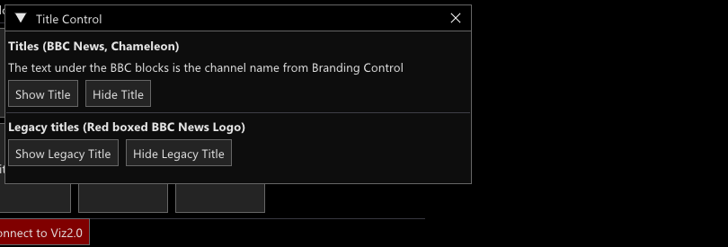
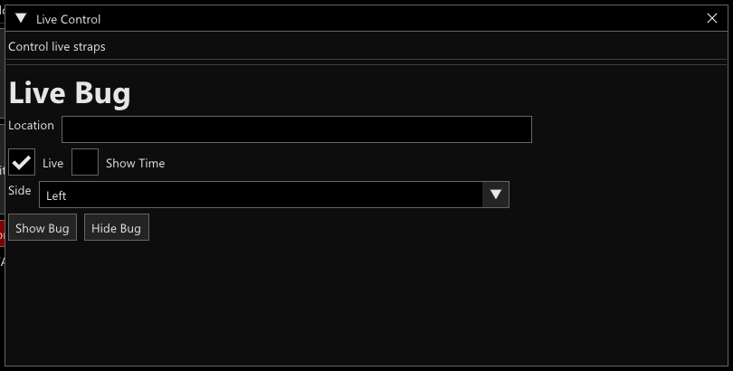
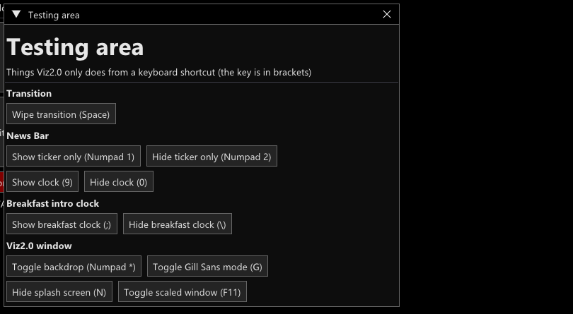

# VizHelper (BGamerManu fork)

The control panel for [Viz2.0](https://github.com/BGamerManu/Viz2.0). It is a [LÖVE](https://love2d.org/) + Dear ImGui program that sends requests to Viz2.0 over the network.

Fork of [playsamay4/VizHelper](https://github.com/playsamay4/VizHelper), made and maintained by Manuel_Ottani. I am trying to keep it updated as far as I can. **It needs the matching fork of Viz2.0**, otherwise the new controls do nothing.

## Installation

1. Download the latest Windows zip from [Releases](https://github.com/BGamerManu/VizHelper/releases). LÖVE 11.4 is inside: unzip it and run `avvia-helper.bat`.
2. Start Viz2.0 first (from the [Viz2.0 release](https://github.com/BGamerManu/Viz2.0/releases)), then VizHelper. The *Connect to Viz2.0* button turns green when they are connected. If Viz2.0 is on another computer, set its IP in the settings (gear icon).
3. Windows only. If it crashes with a missing dll error, install the latest [Visual C++ Redistributable](https://learn.microsoft.com/en-us/cpp/windows/latest-supported-vc-redist?view=msvc-170).

## The windows

| Button | What it does |
|---|---|
| **Aston Control** | Text strap, Breaking strap, Name strap, Programme badge, other badges, News Bar show / hide |
| **Ticker Control** | Ticker text and its default text |
| **Branding Control** | Channel name, theme colour, opaque ticker, coloured straps, clock mode, saved brandings |
| **Headline Control** | One line headline with an optional COMING UP box |
| **Title Control** | Chameleon title (BBC blocks) and the legacy red boxed BBC NEWS logo |
| **Live Bug Control** | LIVE bug with place, optional time and offset, side Left / Right / **Both** |
| **Testing area** | Buttons for what Viz2.0 only does from a keyboard shortcut |

## Aston Control

### Text Strap

A top line is required. Leave *bottom line (1/2)* blank for a one line strap and *(2/2)* blank if the second line should not scroll (`NOP` still works). The last box is the small tag next to the BBC NEWS box (here *IN BRIEF*).

*Show/Update Strap* changes the text of a strap that is already on air, **also from one line to two lines and back, without taking the strap down**.

### Breaking Strap

- An optional BREAKING headline (*Show/Update BREAKING*, then *Scroll BREAKING* moves between BREAKING and its headline).
- The same one / two line text as the text strap (*Show/Update Strap*).
- **Text strap ⇄ breaking strap never lowers the graphic**: the red BREAKING box and tag come up over the strap, or sink away again. If the text is identical only the red box is added or removed, otherwise the text rolls too.

### Programme Badge

Pick a preset in the list (it scrolls), or type a text and colours, then *Show Badge*. *Save badge* adds yours, *Remove selected badge* deletes the selected one.

Presets: ACROSS THE UK, WORLD NEWS TODAY, THE WORLD TODAY, NEWS NOW, THE CONTEXT (red on white), THE CONTEXT USA, BUSINESS TODAY, NEWSROOM LIVE, AFTERNOON LIVE, NEWSDAY, GLOBAL, NICKY CAMPBELL, FOCUS ON AFRICA, G M T, SPORTSDAY, YOUR QUESTIONS ANSWERED. They live in `badges.dat` in the save folder (`%APPDATA%\LOVE\VizHelper`): delete it to get the default list back.

## Branding Control

The program always starts with **News Red Straps** (selected in the list) and sends it to Viz2.0 as soon as it connects, and again when it reconnects. The window is closed at startup: open it to pick another saved branding or to save your own. *Send Branding* sends what the boxes say, including the real *Opaque ticker* value and the *Clock mode*.

## Headline Control

Headlines are one line. A long one is shrunk and then **squashed sideways to stay on screen**, and the BBC NEWS box and the vertical bar follow the height of the text. *Coming Up badge* adds the COMING UP box.

## Title Control

The **Chameleon** title writes **NEWS** under the BBC blocks, or **WORLD NEWS** if the channel name of the branding has "world" in it. The red boxed BBC NEWS logo is under *Legacy titles*.

## Live Bug Control

*Location* is the place, *Live* adds the LIVE box, *Show Time* adds a clock (with an hour offset). **Side** is Left, Right or **Both**: with Both the bug is shown on each side of the screen at the same time (the right one is the mirror image of the left one).

## Testing area

Things Viz2.0 only does from a keyboard shortcut (the key is in brackets): wipe transition, ticker only, clock, breakfast clock, backdrop, Gill Sans mode, hide splash screen and scaled window.

## Changes in this fork

- Live Bug Control: Left / Right / Both.
- Aston Control: one line / in-place BREAKING strap, optional BREAKING headline, text strap ⇄ breaking strap and one line ⇄ two lines without lowering the graphic.
- Title Control (was Tile Control), Testing area, one line Headline Control; Playout Control and Automation are gone.
- Branding Control: News Red Straps sent on connect, window closed at startup, *Send Branding* sends the real *Opaque ticker* value and the *Clock mode*.
- New programme badge presets.
- Bad answers from the RSS server no longer crash the helper at startup (the old `http://rss.playsamay4.com:2082` address now answers with a redirect to HTTPS, which the helper cannot follow, so the *BBC RSS feeds* option has no headlines until that is dealt with).

See the [Viz2.0 readme](https://github.com/BGamerManu/Viz2.0#readme) for screenshots of the graphics themselves.

## License

VizHelper is licensed under the [GNU General Public License v3.0](LICENSE).
